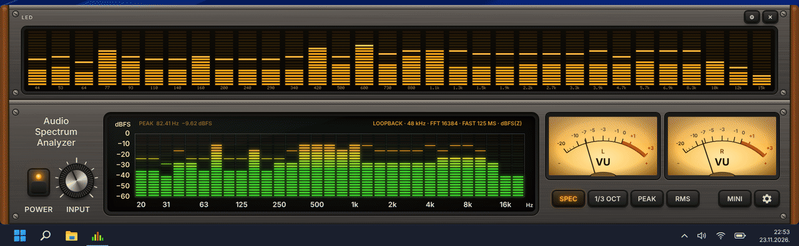
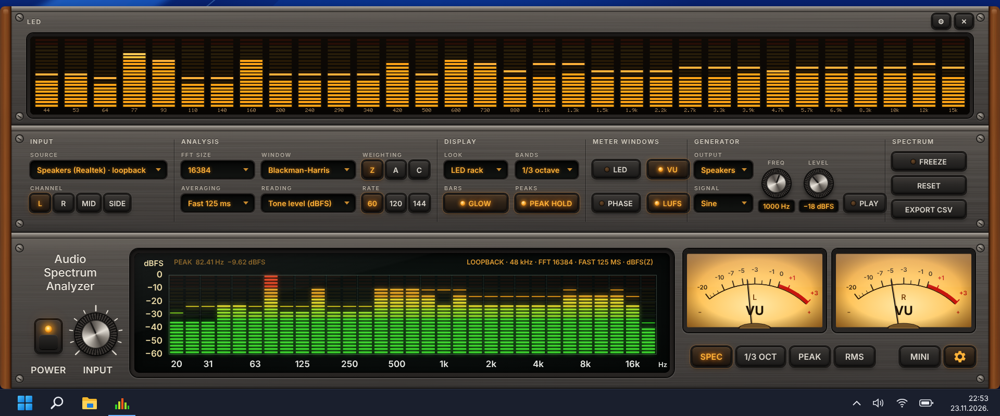
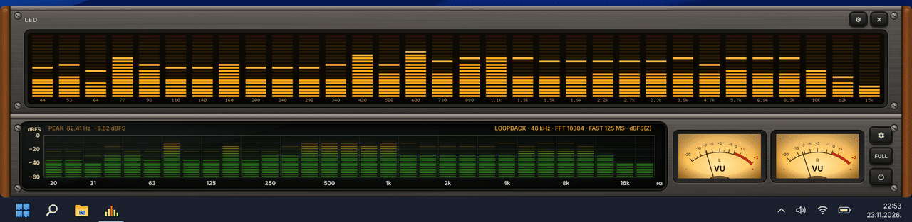

# nSpectrum

A small real-time audio spectrum analyzer for Windows, dressed up as an old hi-fi rack unit:
walnut cheeks, brushed metal, amber VU meters and an LED spectrum.

I wanted something that looks nice sitting above the taskbar while music plays, but still
measures properly when I need it to.



## What it does

- Spectrum of whatever you hear (WASAPI loopback), a microphone or line input
- Several looks: LED rack, dot matrix, measurement, aurora and spectrogram
- FFT from 1k to 64k points, the usual windows, A/C/Z weighting, averaging and peak hold
- Analog VU meters with proper ballistics (0 VU reference selectable, right-click the meters)
- Floating meter windows: LED spectrum, VU/peak, phase/goniometer and loudness (EBU R128)
- Peak frequency, THD and THD+N readout for test tones
- Built-in test signal generator (sine, sweep, white and pink noise)
- Mini mode when the full rack takes too much space
- Every setting is also in the right-click menu
- Export the spectrum on screen to CSV

## Screenshots

Full rack with the options panel open:



Mini mode, when the full rack takes too much space. The LED meter can sit on top at full width:



## Download

Grab the latest zip from [Releases](../../releases):

- `nSpectrum-x.y.z-win-x64.zip` needs the [.NET 10 Desktop Runtime](https://dotnet.microsoft.com/download/dotnet/10.0)
- `nSpectrum-x.y.z-win-x64-standalone.zip` is one exe that runs on its own (bigger download)

Unzip anywhere and run `nSpectrum.exe`. Nothing is installed.

## Using it

- Pick the source with the INPUT knob or in the options panel (gear button)
- Drag the faceplate to move the window, double-click it to dock it back above the taskbar
- **Space** freezes the spectrum, **Ctrl+S** saves it as CSV
- Right-click anywhere on the rack for all settings

## Building

Needs Windows 10/11 and the .NET 10 SDK (or Visual Studio 2026).

```
dotnet build nSpectrum.sln -c Release
dotnet run --project src/nSpectrum.App
```

The spectrum screen is drawn with Direct3D 11, the rest is plain WPF.

## License

MIT, see [LICENSE](LICENSE).
